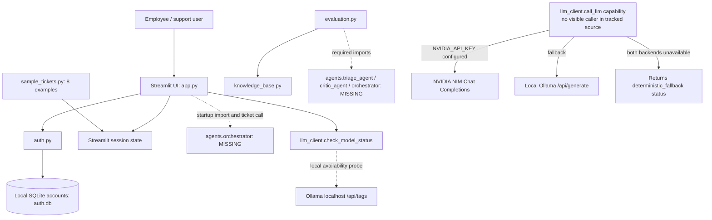
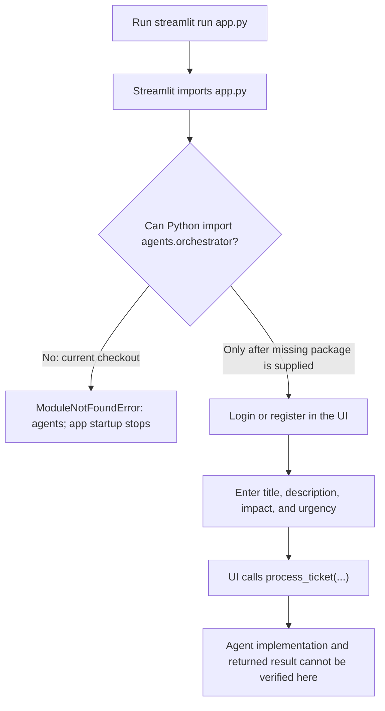

# HelpDesk AI

**A Streamlit-based IT incident triage prototype with local authentication, a curated troubleshooting knowledge base, and an LLM client.**

> **Repository status:** This checkout is incomplete. The UI and evaluation code import an `agents` package that is not present in the repository, so the application cannot currently start and ticket processing/evaluation cannot be run end-to-end. The sections below describe what the checked-in code actually contains and call out this blocker rather than treating UI labels as verified functionality.

## Overview

HelpDesk AI is a prototype for collecting IT support incidents and presenting triage-oriented views for employees, IT support, and SecOps. The checked-in source includes a Streamlit interface, a local SQLite account store, in-memory sample tickets, a small curated IT knowledge base, an HTTP client for NVIDIA NIM and Ollama, and a synthetic evaluation suite.

The UI source calls `agents.orchestrator.process_ticket` when a ticket is submitted. Evaluation imports triage, critic, and routing functions from the same missing `agents` package. Since those modules are not included, the implemented ticket-processing workflow cannot be verified or used from this checkout.

## What is implemented

| Area | Evidence in this repository | Status |
|---|---|---|
| Streamlit interface | `app.py` defines login/registration views, role-scoped navigation, ticket forms, queues, knowledge-base views, settings, and evaluation screens. | Source exists; imports a missing package at startup. |
| Authentication | `auth.py` uses SQLite, per-password salts, PBKDF2-HMAC-SHA256 (120,000 iterations), and constant-time hash comparison. | Implemented locally; not production-ready (see [Security considerations](#authentication-and-security-considerations)). |
| Role-based views and ticket filtering | `rbac.py` defines Employee, IT Support, and Admin/SecOps roles and filters tickets in application code. | Implemented as application-level filtering; role assignment is not trusted or externally provisioned. |
| Ticket data | `sample_tickets.py` contains eight synthetic incidents. New tickets and status changes are held in Streamlit session state. | Local prototype data only; no ticket database or ITSM integration. |
| Knowledge base | `knowledge_base.py` contains ten curated articles and token-overlap/keyword scoring with a relevance threshold. | Implemented; not vector search or semantic retrieval. |
| LLM client | `llm_client.py` has NVIDIA NIM and local Ollama HTTP clients, a 40-requests-per-minute in-process limiter for NVIDIA calls, retries, JSON extraction, and fallback signaling. | Client code exists, but no visible checked-in ticket-processing caller is available because the agent package is missing. |
| Evaluation | `evaluation.py` defines 16 synthetic cases and computes classification, retrieval, safety-verdict, and routing measures. | Source exists; cannot run because its `agents` imports are missing. |
| Presentation generator | `generate_presentation.py` is present in the current workspace but was not part of the tracked file list at audit time. It uses `python-pptx`. | Supplementary local script; not required by the app. |

### Not established by this checkout

- The UI describes a multi-agent/LangGraph workflow, but no agent modules or LangGraph dependency are included. The agent architecture and its implementation cannot be verified.
- The application has no visible ticket persistence, mail intake, service-management integration, automated host containment, or real dispatch to a human queue.
- “Resolve,” “Escalate,” and “Confirm Fix Worked” actions update local session-state ticket fields; they do not call an external ticketing or endpoint-management system.
- The LLM client’s status helper checks whether an NVIDIA key is set and probes local Ollama availability. A configured key is not proof that the cloud API is reachable.

## Technology

- Python (the repository declares no supported version range or dependency manifest)
- Streamlit for the web UI
- Pandas and Altair for in-app tables and charts
- Python standard library: `sqlite3`, `hashlib`, `hmac`, `secrets`, and `urllib`
- NVIDIA NIM Chat Completions API and local Ollama HTTP API in `llm_client.py`
- `python-pptx` for the supplementary presentation script

The words “LangGraph” and “multi-agent” appear in the UI and evaluation comments, but the corresponding package/source is absent; they should not be taken as verified dependencies or functioning components.

## Architecture

The diagram separates available source from unavailable imports. The `call_llm` routes are implemented in `llm_client.py`, but the checked-in application has no visible call site for them. The only direct LLM-client call in `app.py` is the backend status check.



The Streamlit application imports the missing orchestrator before rendering its login screen. Consequently, the UI, auth, and ticket paths shown as source components above are not reachable by launching this checkout until the missing imports and dependencies are restored.

## Ticket workflow

This flowchart shows the current startup result; it does not imply that ticket processing succeeds.



The ticket form’s inputs are **title**, **description**, **impact** (`One user`, `Multiple users`, or `Business-critical service`), and **urgency** (`Work blocked`, `Work impaired`, or `Minor inconvenience`). The code then calls `process_ticket(title, description, impact, urgency)`. The source does not expose a supported HTTP/API endpoint or file-upload format.

## Repository structure

```text
.
├── .gitignore
├── README.md
├── app.py                    # Streamlit UI; imports the missing agents.orchestrator
├── auth.py                   # SQLite account schema, registration, login, password changes
├── evaluation.py             # 16-case synthetic evaluation; imports missing agent modules
├── generate_presentation.py  # Present locally; not tracked at audit time; requires python-pptx
├── knowledge_base.py         # Ten curated SOP articles and keyword/token retrieval
├── llm_client.py             # NVIDIA NIM/Ollama HTTP client and provider status helpers
├── rbac.py                   # Role normalization, view permissions, ticket filters and metrics
└── sample_tickets.py         # Eight synthetic sample incidents and expected labels
```

`agents/`, dependency manifests, `.env.example`, automated test files, and a license file are not present. `auth.db` exists locally but is ignored and is not a source-controlled application database. The app initializes it on import; do not delete or replace an existing database as part of setup.

## Prerequisites and setup

The project does not declare a Python version range or pin dependencies. The audit interpreter was Python 3.14.7, but it had no `pip` module and no third-party packages installed. Use a Python installation that includes `venv` and `pip`; Python 3.11 or newer is a practical starting point, not a declared project constraint.

### Windows PowerShell

From the repository root:

```powershell
py -3.11 -m venv .venv
.\.venv\Scripts\Activate.ps1
python -m pip install --upgrade pip
python -m pip install streamlit pandas altair
```

If `py` is unavailable, use an installed Python executable to create the virtual environment. If PowerShell blocks environment activation, use the virtual environment’s executable directly, for example `.\.venv\Scripts\python.exe -m pip install streamlit pandas altair`.

The app’s visible third-party imports are `streamlit`, `pandas`, and `altair`. The presentation script additionally needs `python-pptx`:

```powershell
python -m pip install python-pptx
```

Installing these packages is not sufficient to make the app run: the missing project-local `agents` package must also be supplied. There is no dependency manifest to install that package from, and no source or package location is identified in this repository.

## Configuration

Set environment variables in the same PowerShell session used to launch Streamlit. Do not place real credentials in this README or commit them.

| Variable | Used by | Notes |
|---|---|---|
| `NVIDIA_API_KEY` | `llm_client.py` | Optional. When set, `call_llm` attempts NVIDIA NIM at `https://integrate.api.nvidia.com/v1`; prompts sent through that client leave the local machine. |
| `HELPDESK_AUTH_SECRET` | `auth.py` | Optional in the current code, which falls back to a hard-coded source value if unset. That fallback is unsafe; see security notes. Changing the secret prevents verification of passwords previously hashed with a different value. |

Example placeholders only:

```powershell
$env:NVIDIA_API_KEY = "<your-nvidia-api-key>"
$env:HELPDESK_AUTH_SECRET = "<your-unique-random-secret>"
```

The Ollama URL (`http://localhost:11434`) and model names are constants in `llm_client.py`, not environment-configurable settings. No `.env` loader is present.

## Run the application

The intended launch command is:

```powershell
streamlit run app.py
```

**It does not currently start successfully from this repository.** In the audited environment, `python -m streamlit run app.py` failed because Streamlit was not installed. After installing the visible UI packages, import of `agents.orchestrator` will still fail because that package is absent. This is a repository blocker, not a configuration value that can be fixed with an API key.

The evaluation entry point is:

```powershell
python evaluation.py
```

It currently fails at import time for the same missing `agents` package. No automated test suite is included.

## Using the interface (once the missing package is restored)

The source defines a login/registration screen and role-specific views for Employee, IT Support, and Admin/SecOps. An employee can enter an incident title and description, choose impact and urgency, and submit the form. IT Support views include triage queue actions; SecOps/Admin views include incident and evaluation screens.

An illustrative form entry, using the actual field choices, is:

```text
Title: Corporate VPN gateway times out
Description: The VPN client cannot reach the gateway from my home network.
Impact: One user
Urgency: Work blocked
```

This is an example of values entered in the UI, **not** a verified successful ticket run or a supported API request. The processing call is blocked by the missing orchestrator implementation.

### Sample ticket data

`sample_tickets.py` contains eight synthetic examples, each with `id`, `title`, `description`, `impact`, `urgency`, expected category/priority/knowledge-base article, and reporter fields. The Streamlit app copies these records into session state at startup and adds status/result fields. New incidents use the same core title/description/impact/urgency values and are associated with the signed-in user. Ticket state is not written to SQLite; it is session-local and should not be treated as durable storage.

## Evaluation and verified results

`evaluation.py` defines 16 curated synthetic cases: standard triage and security incidents, critic safety checks, and a routing case for insufficient knowledge-base evidence. Its code calculates:

| Measure | Cases in code | What is checked |
|---|---:|---|
| Category accuracy | 12 | Deterministic category equals the synthetic expected label. |
| Priority accuracy | 12 | Calculated priority equals the expected label. |
| Security recall | 3 | Security cases are recognized/classified and reach High or Critical priority. |
| KB retrieval hit rate | 12 | Expected article is present among up to two returned articles, or no article is returned for the no-evidence case. |
| Critic exact-match rate | 4 | Both expected verdict and expected `is_safe` value match. |
| Routing accuracy | 12 | Escalation decision and, where specified, escalation tier match. |

These are small, hand-authored synthetic regression checks, not a production dataset. The retrieval measure is a **top-2 hit check**, despite UI text that calls it “top-1.” The evaluator does not compute precision/F1, production resolution success, or a stable latency benchmark.

**No evaluation scores are reported:** the evaluator cannot import the absent agent modules. The only component-level runtime check completed during this audit was a knowledge-base lookup using the first synthetic VPN sample: it returned `KB-NET-001` and `KB-NET-006`, including the sample’s expected `KB-NET-001`. This is one example query, not a benchmark result or an accuracy estimate.

## Authentication and security considerations

- Password hashes are generated with PBKDF2-HMAC-SHA256, a random salt, and `hmac.compare_digest`; account records are stored in a local SQLite file at `auth.db`.
- `HELPDESK_AUTH_SECRET` has a hard-coded fallback in `auth.py`. Do not deploy with the fallback. The fallback is part of the current source and must be replaced through a deliberate secret-management and account-migration plan; changing it invalidates verification for passwords hashed under the old value.
- The code seeds a demo account when the user table is empty, and the login UI contains a demo-credential autofill control. Do not expose that account or demo flow in a shared or production deployment.
- Self-service registration exposes Employee, IT Service Desk, and SecOps role choices. Users can select privileged roles themselves, so the current role checks are not an adequate security boundary for a real organization. Privileged roles need trusted administrative provisioning or an identity provider before deployment.
- Ticket access and ticket state are held in Streamlit session state and local application logic, not in a multi-user ticket service. The local SQLite auth database is not a substitute for managed identity, encrypted backups, audit logging, or production-grade data handling.
- If an integration calls the NVIDIA client with `NVIDIA_API_KEY`, ticket text sent in prompts can be transmitted to NVIDIA’s cloud endpoint. Ollama requests go to `localhost`. Review provider data-handling requirements before sending real incident data. No external model call was made during this audit.
- The UI’s resolution/escalation controls are advisory/local state changes; they do not execute endpoint containment or actually dispatch technicians.

This repository should be treated as a prototype and not used with real credentials, production tickets, or security incident data until these issues are addressed.

## Testing and troubleshooting

Audit checks performed in the available Python 3.14.7 interpreter:

- Parsed all eight root-level Python files with Python’s `ast` module: **passed**.
- Looked up the sample VPN ticket in `knowledge_base.search_knowledge_base`: expected `KB-NET-001` appeared in the two returned articles.
- `python -m streamlit run app.py`: **blocked**, `No module named streamlit`.
- `python evaluation.py`: **blocked**, `No module named agents`.
- Pylance import analysis found unresolved `streamlit`, `pandas`, `altair`, `agents`, and `pptx`; the interpreter had no installed third-party packages.
- `python -m pip --version`: **blocked**, `No module named pip`. No package was installed and no database was modified.
- No test files, CI workflow, `requirements.txt`, or `pyproject.toml` were found.

Common setup failures:

| Symptom | Cause / next step |
|---|---|
| `No module named streamlit` | Install the visible UI dependencies in the active virtual environment and run through that environment. |
| `No module named agents` | The project-local agent implementation is missing; obtain/restore the correct source before expecting app startup or evaluation to work. |
| `No module named pip` | The selected Python installation lacks pip. Create the environment from a Python installation with `venv`/`pip` support; do not install packages globally. |
| NVIDIA calls fail or fall back | Confirm `NVIDIA_API_KEY`, model access, and network/provider availability. A set key alone is not a connectivity check. |
| Existing users cannot authenticate after changing `HELPDESK_AUTH_SECRET` | Password verification is keyed by the configured secret; plan migration or user re-registration instead of deleting or replacing `auth.db`. |

## Limitations and future work

1. Restore and track the `agents` package and document its real dependency versions and control flow.
2. Add a dependency manifest and automated tests, including tests for RBAC, role assignment, retrieval, and evaluation.
3. Replace the hard-coded auth secret and demo account flow; restrict privileged role assignment to trusted administrators or an identity provider.
4. Persist tickets in a documented, access-controlled store and integrate actual dispatch/ITSM workflows only with explicit authorization.
5. Expand evaluation with held-out and representative data, report precision/recall/F1 where appropriate, and add latency and end-to-end processing measures.
6. Add privacy controls and logging that avoid storing secrets or unnecessary incident details.

## Contributing

Contributions should be based on the actual source and clearly distinguish verified behavior from planned functionality. Before opening a pull request:

1. Describe the problem and intended behavior.
2. Add or update focused tests when the missing agent package and test setup are available.
3. Run the relevant tests and include the exact command and result.
4. Do not commit `.env` files, API keys, local databases, virtual environments, or generated artifacts.

The repository currently has no dependency manifest or test suite; changes that add either should document reproducible setup and validation.
